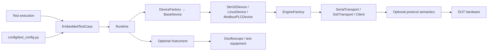
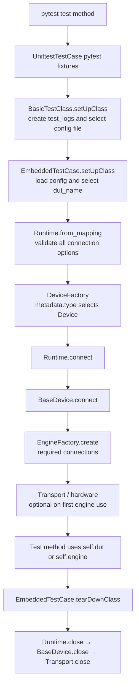
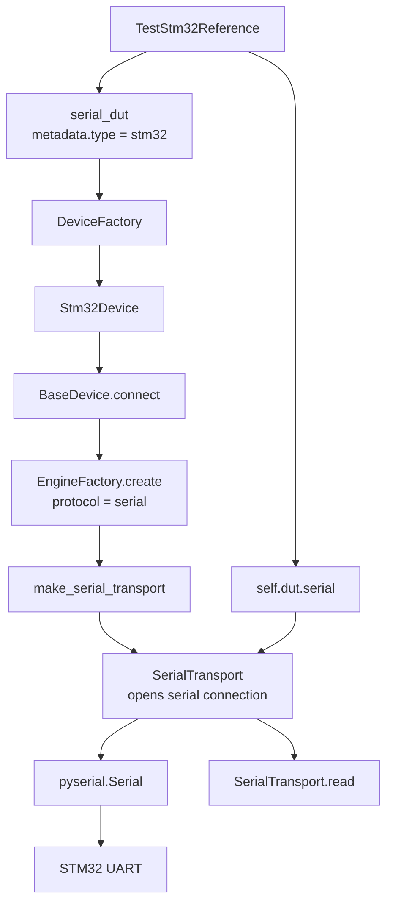
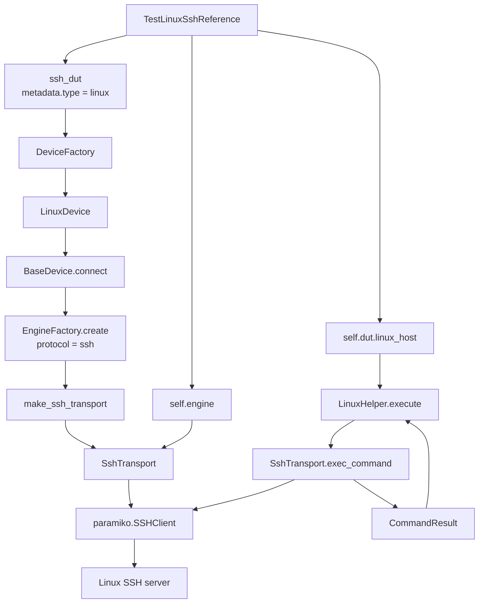

# Embedded Framework

Embedded Framework is a product-independent Python foundation for communicating
with embedded devices and initializing generic devices under test (DUTs).

It provides:

- communication clients for ADB, CAN, MQTT, SSH, FTP/FTPS, HTTP/HTTPS, TCP/UDP
  sockets, serial ports, and WebSocket;
- configuration loading from JSON or TOML, with environment-variable
  substitution;
- configuration-driven connection creation and DUT lifecycle management;
- common host, file, network, and shell helpers;
- structured logging, assertions, timeouts, timers, and polling utilities.

## Install

```bash
python -m pip install -e ./embedded_test_framework
```

For development tools:

```bash
python -m pip install -e "./embedded_test_framework[dev]"
```

## Initialize a DUT

Create a JSON or TOML configuration that declares named connections and DUTs.
Connection passwords and tokens may use `${ENVIRONMENT_VARIABLE}` values.

```python
from embedded_test_framework.runtime import initialize

with initialize("devices.toml") as runtime:
    linux = runtime.duts["target"]
    result = linux.execute("uname -a")
    print(result.stdout)
```

`execute()` is a Linux/Android shell API. Other devices expose only their supported
operations, such as `Stm32Device.serial()` or Modbus PLC register access.

See [the communication package](communication/README.md) for the
transport interfaces and connection configuration fields.

Connections are required by default and open during `Runtime.connect()`. Set
`"required": false` for an optional connection (for example MQTT on a Linux
DUT); it is validated during setup but opens only when `device.engine("mqtt")`
or the adapter API first uses it.

颜色敏感截图、色块及热成像伪彩色测试见 [ImageRecognitionHelper 使用说明](helpers/IMAGE_RECOGNITION.md)。

## Serial command helper

Use the configured transport; the DUT still owns its connection and cleanup.

```python
from embedded_test_framework.helpers.he_serial import SerialHelper

transport = self.dut.serial()  # STM32; or self.dut.engine("serial") for a named connection
serial = SerialHelper(transport)
serial.send_command("AT", eol="\r\n")          # AT module: CRLF
serial.send_command("status", eol="\n")        # firmware console: LF
serial.send_command("AA 01 00 FF", hex_mode=True)  # binary frame, no added bytes
serial.send_command(b"\xaa\x01\x00\xff")       # already assembled binary frame
response = transport.read(4)  # up to 4 bytes; uses configured read_timeout
print(response.hex(" "))
```

`send_command()` defaults to no line ending. Set `eol="\r"` for CR,
`"\n"` for LF, or `"\r\n"` for CRLF. Text defaults to UTF-8; use
`encoding="gbk"` or another device encoding when needed. Hexadecimal text
accepts whitespace or contiguous pairs, without `0x` prefixes. Raw `bytes`
are unchanged. The return value includes all transmitted bytes and the terminator.
An incomplete write raises `OSError`; commands are never automatically retried.

Choose the terminator from the device protocol; binary frames usually need none.
The helper adds no CRC, clears no receive buffer, and does not interpret replies.
Reads can return fewer bytes on timeout; assemble and validate responses according
to the device protocol. Use the existing Modbus protocol for Modbus RTU frames.
Do not share a transport concurrently with another reader or command sender.

## System-test example

The SSH command and SCP upload examples are in `system_tests/test_examples/`.
Update the DUT addresses and credentials in `config/test_config.py`, then run
them from the repository root:

```bash
python -m pytest -v system_tests/test_examples/test_ssh_command.py system_tests/test_examples/test_scp_upload.py
```

The test class inherits from `embedded_test_framework.embedded_test_base.EmbeddedTestCase`.
Set `dut_name` for one DUT, or `dut_names` for several; all selected DUTs are
available through `self.duts`, and the first is also available as `self.dut`.

## CI results (JUnit XML)

Pytest writes the CI result file; the framework does not need a report plugin.
Use the same command in a test runner that Jenkins uses for system tests:

```bash
mkdir -p test-results
python -m pytest -q system_tests/test_examples \
  --junitxml=test-results/junit.xml \
  -o junit_logging=all \
  -o junit_log_passing_tests=false
```

`junit.xml` contains each case's pass/fail/error result, failure traceback, and
captured logs for failed cases. Publish it in Jenkins with
`junit testResults: 'test-results/junit.xml'`; archive `test_logs/**` separately
for ReportCenter and Artifactory. The included framework `Jenkinsfile` already
does this for framework unit tests. The external system-test runner must create
the same `test-results/junit.xml` file because `system_tests/Jenkinsfile`
already copies and publishes that exact path.

For tests using the framework test base, setup, call, and teardown failures
are also written to `test.log` with the node ID, stage, and full traceback.
The reporter preserves an independent long traceback, so `--tb=no` or
`--tb=short` does not remove the trace from framework artifacts. At session
finish, each failed case also gets `# 2. Error Text` and `# 3. Call Trace` in
its `summary.txt`; call and cleanup failures are both retained. Successful
cases contain only the test context.

Logging formats a copy of each record and retains complete multiline messages,
mapping arguments, exception chains, and exception groups in all handlers.

Raw Transport/Client `execute()` returns a `CommandResult` even for nonzero
exit codes. Use `result.check()` or the checked Device/Helper interface when
that result should fail the test; a passing test has no failure traceback.

## Write system tests

Put shared DUT settings in `config/test_config.py`. A system-test subclass
declares the capability and connection it needs; `EmbeddedTestCase` validates
the capability after `Runtime.connect()` and exposes the selected connection as
`self.engine`.

```python
from embedded_test_framework.devices import Capability
from embedded_test_framework.embedded_test_base import EmbeddedTestCase


class TestLinuxFeature(EmbeddedTestCase):
    dut_name = "ssh_dut"
    required_capabilities = (Capability.SHELL,)
    engine_name = "ssh"

    def test_os_release(self) -> None:
        # GIVEN a configured Linux DUT
        # WHEN its OS release is read
        os_release = self.dut.linux_host().read_text("/etc/os-release")

        # THEN it identifies a Linux distribution
        self.assertTrue("ID=" in os_release)
```

Use `GIVEN`, `WHEN`, and `THEN` comments in every system-test method:

- **GIVEN**: configured device state and input data.
- **WHEN**: the single action under test.
- **THEN**: observable assertions.

Do not add pytest markers or `pytest.ini` for these tests. Hardware that is
not configured must use a `TESTCONFIG` that defines its required connections
and capabilities.

```python
config = {
    "devices": {
        "linux_dut": {
            "metadata": {"type": "linux"},
            "default_connection": "ssh",
            "connections": {
                "ssh": {"protocol": "ssh", "options": {"address": "192.0.2.10", "username": "operator", "password": "${SSH_PASSWORD}"}},
                "mqtt": {"protocol": "mqtt", "required": False, "options": {"host": "192.0.2.20"}},
            },
        }
    }
}
```

## Framework overview

The public path is deliberately short: tests use Device or Instrument APIs;
factories remain Runtime implementation details.



## System-test call chains

Every `EmbeddedTestCase` follows this framework lifecycle. `Runtime` owns all
configured connections; individual test methods must not close them.



### STM32 UART reference chain

`TestStm32Reference` selects `serial_dut` from `config/test_config.py`.
`STM32_REFERENCE_PORT` supplies its serial port value.



The UART case reads ten raw chunks. It does not call `connect()` or `close()`:
the Runtime has already opened the port and owns its cleanup.

### Linux SSH reference chain

`TestLinuxSshReference` selects `ssh_dut`, declares
`Capability.SHELL`, and requests the `ssh` engine. `EmbeddedTestCase` validates
the capability and exposes the connected transport as `self.engine`.



Use `self.dut.linux_host()` for Linux filesystem, memory, and process operations.
Use `self.dut.execute()` or `self.dut.linux_host().execute()` when the test needs a `CommandResult` with an
exit status.

### Linux 命令的职责与结果

```python
from embedded_test_framework.lib.command_result import CommandResult

linux_host = self.dut.linux_host()
result = linux_host.execute("uname -a", timeout=10)
print(result.stdout, result.stderr, result.exit_code, result.duration)
```

`SshTransport.exec_command(command, timeout=...)` 负责 SSH 通信、超时和执行计时，
返回 `CommandResult`，非零退出码也正常返回；通信或超时故障抛 `SSHCommandError`。
`LinuxDevice.linux_host(connection=None)` resolves an SSH connection and returns a bound `LinuxHelper`.
Call `linux_host.execute(command, timeout=10)` to run a command and check its exit code;
use `check=False` to inspect a failed result. Device `execute()` delegates to the helper,
and device `shell()` remains a compatibility alias. File, memory, and program operations
also live in `LinuxHelper` (module `helpers/he_linux_host.py`).

`CommandResult` 定义在 `lib/command_result.py`，不依赖设备或通信模块。
`stdout`/`stderr` 为字符串，`exit_code` 为整数，`duration` 为耗时秒数；SSH 耗时包含
等待连接锁、执行和输出读取，ADB 耗时包含子进程启动、命令执行及输出读取，不包含 Runtime 初始化时的设备状态检查。
旧 `exit_status` 属性及构造参数保留为 `exit_code` 的兼容别名；从
`helpers.he_linux_host` 导入也仍指向同一个类。手动构造且未提供计时的结果 `duration=0.0`。
SSH 的 `execute()/shell()/exec_command()` 返回原始 `CommandResult`。旧 `do_command()`
保留受检查的字符串返回，`do_command_w_exitstatus()` 保留三元组；两者直接适配同一个执行核心。

### 命令接口、连接选择与超时

| 层 / 接口 | 命令含义 | 返回值与失败处理 |
| --- | --- | --- |
| LinuxDevice / AndroidDevice `execute()/shell()` | 设备 shell 字符串 | `CommandResult`；默认检查退出码 |
| LinuxHelper `execute()/shell()`；AndroidHelper `execute()/shell()/command()` | shell 字符串；ADB command 使用独立参数 | `CommandResult`；默认检查退出码 |
| SshTransport `execute()/shell()/exec_command()` | 设备 shell 字符串 | 原始 `CommandResult`，非零退出码不抛错 |
| AdbClient `execute()/shell()`；`command(*args)` | shell 字符串；显式 ADB 子命令和参数 | 原始 `CommandResult`，非零退出码不抛错 |

通信/子进程调用异常和操作超时始终抛专用异常；`check=False` 只关闭退出码检查。
Helper 的文件、内存等派生操作保留其字符串、数字或布尔返回值。

BaseDevice 持有连接并负责状态检查、选择、首次创建和释放。协议入口统一按以下顺序选择：

1. 显式 `connection` 别名：必须存在且协议匹配，否则直接报 `DeviceStateError`。
2. 未指定时，若 `default_connection` 的协议匹配，就使用它。
3. 否则只允许唯一匹配协议的连接；没有匹配或存在多个匹配时明确报错。

空字符串和错误类型不会回退默认连接。`engine()` 不指定协议时仍使用配置默认连接。
设备能力由实际配置的协议推导；连接别名无需等于协议名。`engine_name` 仅选择测试基类的
原始 `self.engine`，不修改 DUT 默认连接；需要同一连接时应显式绑定 Helper。

LinuxDevice/AndroidDevice 只把所选连接绑定给 Helper；通用 Linux 服务操作位于 LinuxHelper。
Helper 不创建或关闭连接。关闭 DUT 后不要继续使用旧 Helper，应重新连接并重新获取。

所有 shell/ADB 命令的 `timeout=None` 都继承所选 Transport/Client 的默认值。
每次调用指定有限正数只覆盖本次操作；Helper 不再隐式覆盖为 30 秒，bugreport 也不再默认 120 秒。
SSH 工厂默认 `timeout=10`，ADB 工厂默认 `timeout=30`；配置相应连接的 `options.timeout` 可修改。
SSH 的同一配置值也用于连接尝试；连接重试和握手不属于单条命令的总时限。
SSH 操作时限包含等待连接锁、执行和读取输出；ADB 命令包含启动子进程及输出读取。
连接由 Runtime/工厂或显式 `connect()` 建立，命令执行不会自动重放或隐式重连。
超时不能保证设备上脱离会话的进程已经停止。

```python
host = linux_dut.linux_host(connection="control")
result = host.execute("uname -r")               # 继承 control 的 timeout
result = linux_dut.shell("false", connection="control", check=False)
print(result.exit_code, result.stdout, result.stderr)

android = android_dut.adb(connection="usb")
result = android.execute("getprop ro.product.name", timeout=5)
result = android.command("push", "local file", "/sdcard/file")
result = android.bugreport(timeout=120)         # 慢操作显式覆盖

raw = linux_dut.engine("control")
result = raw.execute("false")                  # 保留失败结果
result.check()                                # 需要时由调用方检查
```

迁移：SSH/ADB 的 `execute()` 不再返回字符串，取文本应使用 `.stdout`；
Android 不再自动解析 `"adb ..."` 前缀，设备命令写 `execute("getprop ...")`，
ADB 操作写 `command("push", source, destination)`。配置 serial 固定设备，command 不接受全局选项覆盖。
旧 SSH `do_command()/do_ssh_command()` 保留受检查字符串返回；`do_command_w_exitstatus()` 保留三元组。
旧 `time_out=None` 也继承连接默认值；`rcvd_timeout` 若提供则作为本次时限的上限。

### Linux 程序执行示例

```python
shell = self.dut.linux_host()
kernel = shell.get_kernel_version()  # uname -r，例如 6.6.12-custom
shell.make_executable("/opt/product/my app")  # chmod u+x，保留其他权限位
result = shell.run_program("/opt/product/my app", "--config", "/tmp/test config.json", timeout=60)
print(result.stdout, result.stderr, result.exit_status)

# PATH 中的程序直接传名称；当前目录中的程序使用 ./app。
version = shell.run_program("uname", "-r").stdout.strip()
result = shell.run_program("/opt/product/check", check=False)
assert result.exit_status in (0, 2)

# 仅在明确持有待终止进程 PID 时使用：
# shell.kill_process(pid)  # 发送 SIGTERM；不等待或保证进程退出
```

`run_program()` 的参数分别传入，作为字面值转义；`"a b"` 是一个参数，
不会执行参数中的 `$()`、分号等 shell 语法。需要管道/重定向时使用
`shell.execute("受信任的 shell 命令")`，不要直接拼接外部输入。
新增命令接口默认在非零退出码时抛出异常；`execute()` 和 `run_program()`
可使用 `check=False` 自行判断。旧文件/内存方法的返回类型保持不变。

程序以前台方式运行，不自动 sudo、提权或转为后台服务。`make_executable()`
只增加文件所有者的执行权限，路径相对于远端登录目录解析。`timeout` 传给
现有 SSH 引擎，不是远端进程的强制运行时限；超时后不能假定程序已停止。
SSH 命令执行失败或超时后不自动重放命令；调用方确认设备状态后再决定是否重试。

### 异步 iperf3 与持续 ping

DUT 需安装 `iperf3`、Linux iputils 的 `ping` 和支持 `-k` 的 GNU `timeout`。
测速对端需事先运行 `iperf3 -s`。不自动安装工具或启动服务器。

```python
import asyncio

async def measure(shell):
    upload = await shell.iperf("192.0.2.10", direction="upload", duration=10)
    download = await shell.iperf("192.0.2.10", direction="download", duration=10)
    both = await shell.iperf("192.0.2.10", direction="bidirectional", duration=10)
    print(upload["end"], download["end"], both["end"])

# 同步测试方法中：asyncio.run(measure(self.dut.linux_host()))
# 已有事件循环的异步测试中：await measure(self.dut.linux_host())
```

方向以 DUT 为客户端定义：上行 DUT→服务器，下行服务器→DUT，双向同时发送/接收。
使用 TCP，默认端口 5201；双向要求设备上的 iperf3 支持 `--bidir`。
返回完整 JSON 字典，吞吐量字段 `bits_per_second` 单位为 bit/s；双向报告保留各方向
原有字段，不将它们相加。非零退出码、JSON 错误或报告中的 `error` 会抛异常。
参数含义见 [iperf3 官方说明](https://software.es.net/iperf/invoking.html)。

```python
from contextlib import aclosing

async def monitor(shell):
    async with aclosing(shell.ping("192.0.2.10", interval=1, reply_timeout=2)) as results:
        async for result in results:
            print(result.exit_status, result.stdout)
            # 根据测试条件 break，或由调用方取消 monitor 任务。
```

`ping()` 为异步生成器，每次发送一个包并返回 `CommandResult`，持续到关闭或取消。
退出码 0 表示收到回复，1 表示未收到回复（继续监测），其他错误会抛异常。
`interval` 是消费完本次结果后到下次探测的等待秒数，不是精确发包周期；每次 ping
单独启动，因此不提供跨多次探测的累计丢包率，也不在内存中累积结果。

两者复用阻塞 SSH 引擎，在工作线程运行，不阻塞 asyncio 事件循环。
同一 SSH 引擎有锁，命令仍然串行；要边测速边 ping，应使用两个独立配置的 SSH
连接创建两个 LinuxHelper，不能仅把同一个引擎包装两次。
远端 `timeout` 为 iperf 设置 duration+10 秒、为单次 ping 设置 reply_timeout+2 秒的
时限，再给予 2 秒强制终止宽限。取消任务会等待当前工作线程收尾，非立即返回；
应先等待异步任务结束，再关闭 Runtime/DUT。

The inherited `test_zzzz_check_for_crashes` case scans Linux DUTs with SSH
connections. Detected core files always fail the check, even when downloading
the artifacts fails. Downloads are attempted for every detected file; failures
are logged. Scan failures and invalid path metadata raise an exception group
after the remaining DUTs have been checked.

The default scan paths are `/var/lib/systemd/coredump` and `/var/crash`. Every
configured scan path must exist and be readable; missing paths also fail the
scan. Set device metadata to the paths present on the target, for example
`"coredump_paths": ["/var/lib/systemd/coredump"]`. Artifact targets are under
`test_logs/<run>/<test-class>/test_zzzz_check_for_crashes/coredumps/<dut-name>/`;
a failed download may leave the expected artifact absent or incomplete.

Registered method and class cleanups all run in reverse order. Any cleanup
errors are then raised as an exception group, so pytest reports the cleanup
failure instead of silently passing the test.

## Extend the framework

Add a class only when it owns real behavior that cannot live in an existing
class. Configuration remains centralized in `config/test_config.py`; tests do
not define connection settings.

### Add a device

1. Add a `BaseDevice` subclass under the appropriate `devices/` category.
   Declare its static `capabilities` and expose only the APIs matching those
   capabilities. Declare protocol-derived capabilities in
   `connection_capabilities`; they are available only when that protocol is
   configured. For example, an STM32 adapter exposes `serial()`; it does not
   inherit Linux shell methods.
2. Add exactly one `metadata.type` entry to `DeviceFactory` in
   `devices/base.py`. `generic` remains the default for configurations that do
   not need a device-specific adapter.
3. Set that type in `config/test_config.py`, then add a small unit test for
   factory selection and the device API. Run hardware checks with a
   `TESTCONFIG` that defines the target's required connections.

`metadata.type` identifies the DUT family. A configured protocol adds a
capability only when that adapter declares it in `connection_capabilities`.
A `stm32` or `linux` DUT may expose MQTT alongside serial or SSH, so do not
create a separate MQTT-only device type for an existing DUT.

### Add an engine

An engine is a connection implementation, not a device adapter. Add one only
when the endpoint/client behavior is genuinely new.

1. Put the sole implementation in `communication/<name>.py`; it must provide
   `close()`. Use `BaseTransport` only when its `connect()`, `disconnect()`,
   and `is_connected` lifecycle actually fits.
2. Provide a `make_<name>()` builder and register that builder once in
   `_FACTORIES` and its logger name in `_ENGINE_LOGGER_NAMES` in
   `configurator/configurator_dut.py`.
3. Add the connection protocol/options to `config/test_config.py` and test
   validation with a fake factory. Do not connect hardware from
   `Runtime.from_mapping()`; opening happens only at `Runtime.connect()`.

Do not register a non-serial engine as `serial`: `EngineFactory` opens serial
connections through the serial transport lifecycle.

### Add a protocol

A protocol owns frames, commands, parsing, and domain responses; a transport
owns the endpoint connection. Put a protocol in `protocols/<name>/` and make it
consume an existing transport rather than opening sockets or serial ports.

1. Start with a concrete protocol class. Add a protocol base class only when a
   second real implementation or an injected test adapter needs that contract.
2. Expose protocol operations through the matching device adapter, not through
   `device.type` branches in tests or business code.
3. Unit-test encoding/parsing with a fake transport, then add one hardware
   system test that skips when its configuration is absent.

This keeps the public path small: test -> device/instrument ->
communication/protocol -> hardware. `Runtime`, `DeviceFactory`, and
`EngineFactory` remain internal assembly code.

## Scope

This repository intentionally contains only reusable embedded-device framework
code. Product DUT models, feature implementations, test suites, deployment
files, and generated artifacts are excluded.
